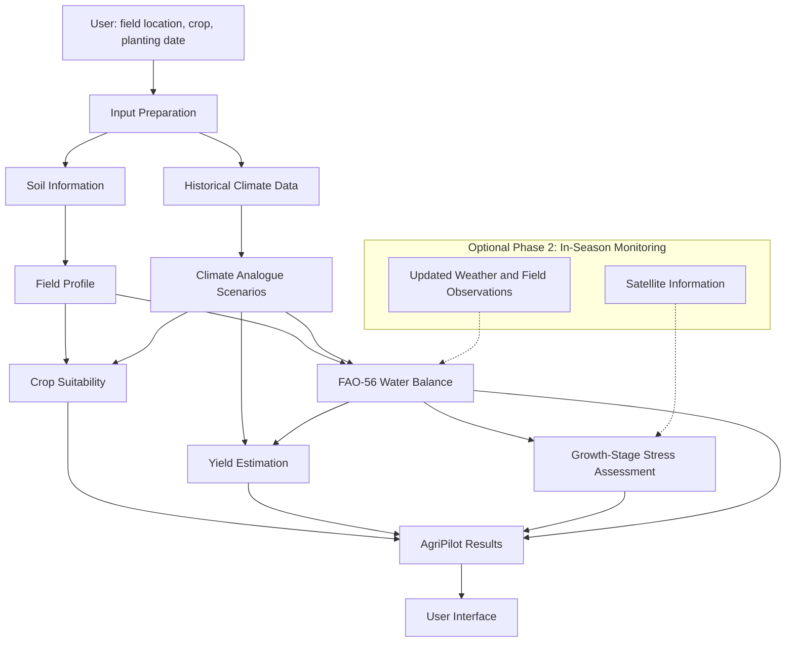

# AgriPilot — Capstone Project Concept Note and Implementation Plan

**Project title:** AgriPilot (Arki Pilot) — An Explainable Agricultural Decision-Support Platform for Syrian Farmers  
**Team member:** Jawad Osama Alshepli Azzam  , Mahmoud-Mamo , dalaa hag mohammad  , Hashem kurdieh , Mohammed Rabea Mobayed 
**Project period:** 3 November–10 December 2026 --> 10 December 2026 

# Part A — Concept Note

## 1. Project Overview

AgriPilot is an agricultural decision-support platform designed to help Syrian farmers plan crop selection and water use before the growing season. The user selects a field location, crop and planting date. The system combines soil and historical climate information with agronomic calculations to provide a season-ahead plan.

The core version focuses on five Syrian governorates Hasakah, Aleppo, Hama, As-Suwayda and Tartus and four crops: wheat, barley, maize and cotton. It provides four main outputs:

1. **Crop suitability:** a comparison and ranking of the selected crops according to the field's soil and climate conditions.
2. **Indicative yield estimation:** an estimated yield with a range across the climate scenarios.
3. **Growth-stage stress assessment:** indicators of potential water, heat and frost stress during sensitive crop stages.
4. **Irrigation planning:** an advisory irrigation schedule based on the FAO-56 water-balance method.

The project supports the following Sustainable Development Goals: **SDG 2 (Zero Hunger), SDG 6 (Clean Water and Sanitation), SDG 13 (Climate Action), and SDG 1 (No Poverty).**

**Problem addressed:** Syrian farmers face water scarcity, irregular rainfall, drought and heat, which complicate crop selection and irrigation decisions. Agricultural information is often spread across different sources and is not always easy to interpret at field level.

**Expected contribution:** AgriPilot brings relevant soil, climate and agronomic information into one understandable planning workflow. It is intended to support farmers' decisions, not replace their experience or professional agricultural advice.

## 2. Project Objectives

- Develop a field profile using the selected location and available soil information.
- Compare the suitability of wheat, barley, maize and cotton across the five target governorates.
- Generate dry, average and wet climate scenarios from historical climate analogues.
- Estimate indicative crop yield and show how it changes between scenarios.
- Assess water, heat and frost stress by crop growth stage.
- Produce an advisory irrigation schedule using FAO-56.
- Present the main factors behind the results in a clear and understandable way.

## 3. Background

Crop performance depends on interactions between climate, soil, crop requirements and water availability. In Syria, seasonal rainfall variation and water scarcity make these factors particularly important for planning. Existing approaches include crop-water models, climate datasets and satellite-based crop monitoring. AgriPilot combines an agronomic foundation with data analysis and machine-learning support, while keeping its main outputs understandable.

The project has two distinct phases:

### Phase 1 — Core: Season-ahead planning

Phase 1 is the main project deliverable. It uses the field location, crop, planting date, soil information and historical climate data to compare the planned season with historical climate conditions. The system presents **dry, average and wet scenarios** and generates crop suitability, indicative yield, growth-stage stress indicators and irrigation advice. The scenario selection is based on the distribution of seasonal rainfall across the historical analogue years.

The core planning workflow is designed around the available soil and climate information and does not depend on satellite imagery, connected sensors or daily farmer observations.

### Phase 2 — Optional: In-season monitoring

Phase 2 is an optional extension that may add satellite observations such as Sentinel-2 vegetation indices, updated weather information and field observations. Work on this phase will include identifying and accessing suitable satellite information that can support monitoring during the growing season. These features are not required for the Phase 1 season-ahead plan.

## 4. Methodology

AgriPilot follows a sequence of data preparation, scenario generation and agricultural analysis:

1. **Field definition:** the user selects the governorate and field location, crop and intended planting date.
2. **Input preparation:** soil properties and historical climate information are assembled for the selected field.
3. **Climate scenarios:** the planner compares the crop season with historical analogue years and selects dry, average and wet conditions using the 15th, 50th and 85th percentiles of seasonal rainfall.
4. **Crop suitability:** crop requirements are compared with the available soil and climate characteristics to rank the four crops.
5. **Water balance and irrigation:** the FAO-56 approach is used to estimate crop water requirements and prepare an advisory irrigation schedule.
6. **Stress assessment:** water deficit and relevant heat or frost conditions are assessed in relation to crop growth stages.
7. **Yield estimation:** an indicative yield estimate is produced using the project's yield-estimation approach and compared across scenarios.
8. **Results presentation:** the interface presents the planning outputs and the main factors that influence them.

## 5. System Architecture

**Main components:**

- **Input preparation and field profile:** organizes the selected field details and soil information.
- **Historical climate and scenario engine:** prepares analogue climate seasons and the dry, average and wet scenarios.
- **Crop-suitability module:** compares crop requirements with field conditions.
- **FAO-56 water-balance module:** estimates crop water needs and prepares irrigation advice.
- **Yield-estimation module:** estimates yield under the selected scenario.
- **Stress-assessment module:** identifies potential stress during sensitive growth stages.
- **User interface:** presents the results in a clear format.
- **Optional Phase 2 inputs:** satellite information and updated field observations can support in-season monitoring.

## 6. Data Sources

The core version uses historical climate information from the ERA5-Land dataset, accessed through the project's weather-data workflow, and soil information from SoilGrids or the field profile. These sources provide the climate and soil context required for the Phase 1 planning functions. The optional Phase 2 may use Sentinel-2 satellite imagery, including vegetation indicators such as NDVI and NDMI, together with updated weather or field observations to support monitoring during the growing season.

## 7. Literature Review

FAO Irrigation and Drainage Paper 56 (Allen et al., 1998) provides the crop-water and irrigation-scheduling method used as the agronomic basis for AgriPilot, while FAO Paper 33 (Doorenbos & Kassam, 1979) describes the relationship between water deficit and yield response. Research on ERA5-Land and SoilGrids supports the use of gridded climate and soil information in agricultural analysis. Sentinel-2 vegetation indices are relevant to crop monitoring during the season and are therefore considered for the optional second phase. Machine-learning methods can support analysis of interactions between climate, soil and crop factors, while the project combines them with agronomic calculations to keep the planning outputs interpretable.

---

# Part B — Implementation Plan

## 1. Technology Stack

| Area | Technology | Purpose |
|---|---|---|
| Programming | Python | Main development language |
| Backend | FastAPI | Application services and planning endpoints |
| User interface | Streamlit | Farmer-facing interface |
| Data processing | pandas, NumPy, xarray | Climate and soil data preparation and calculations |
| Geospatial data | rasterio / GeoPandas, where needed | Handling spatial datasets |
| Climate data | ERA5-Land through the project weather-data workflow | Historical climate information |
| Soil data | SoilGrids and field-profile inputs | Soil characteristics |
| Agronomic calculations | FAO-56 and crop requirement parameters | Water balance, irrigation and crop analysis |
| Machine learning | scikit-learn / Gradient Boosting | Supporting yield estimation |
| Explainability | SHAP, where applicable | Showing factors influencing model outputs |
| Storage | SQLite and Alembic | Prototype data storage and database migrations |
| Testing and version control | pytest, Git and GitHub | Testing and project source management |
| Optional Phase 2 | Sentinel-2 data and field observations | In-season monitoring |

## 2. Updated Implementation Timeline

The implementation schedule below covers the remaining period from the current submission on **20 November** to the final project and presentation deadline on **10 December 2026**.

| Dates | Work stage | Main tasks and expected result |
|---|---|---|
| **3–10 November** | Project definition | Project announcement on 3 November; refine the project idea and submit the idea proposal on 10 November. |
| **11–19 November** | Initial research and planning | Review the project scope, identify the core data and methods, and prepare the project structure and initial documentation. |
| **20–23 November** | Data and core workflow preparation | Finalize the core input data workflow, prepare field and crop inputs, and organize the historical climate and soil information required by Phase 1. |
| **24–28 November** | Core agricultural modules | Complete and connect crop suitability, climate scenarios, yield estimation, growth-stage stress assessment and FAO-56 irrigation planning. |
| **29 November–3 December** | System integration and testing | Integrate backend and interface, test the complete Phase 1 workflow, review outputs and correct issues. |
| **4–6 December** | Optional Phase 2 investigation and documentation | Identify suitable satellite data sources for possible in-season monitoring; document the optional extension without making it a dependency of Phase 1. |
| **7–8 December** | Final project preparation | Finalize project documentation, organize demonstration examples and prepare presentation slides. |
| **9 December** | Review and rehearsal | Check the complete demonstration, review the presentation and make final corrections. |
| **10 December** | Final submission | Submit the completed project and deliver the presentation. |

## 3. Milestones

1. **Project idea submitted — 10 November:** initial AgriPilot idea delivered.
2. **Planning documents submitted — 20 November:** Concept Note, Implementation Plan and Literature/Data/Technology Review delivered.
3. **Core workflow completed — 28 November:** Phase 1 planning functions connected.
4. **Integrated prototype tested — 3 December:** end-to-end workflow and main outputs reviewed.
5. **Final project and presentation ready — 9 December:** documentation and presentation finalized.
6. **Final submission — 10 December:** project and presentation submitted.

## 4. Challenges and Mitigation

| Challenge | Planned response |
|---|---|
| Climate variability across locations | Use historical climate scenarios to compare different possible conditions. |
| Differences in soil and crop requirements | Use field soil information and crop-specific agronomic parameters. |
| Complexity of irrigation decisions | Use the FAO-56 water-balance method as the basis for irrigation advice. |
| Limited time before the final deadline | Prioritize the complete Phase 1 workflow and keep Phase 2 optional. |
| Satellite information for monitoring | Investigate suitable sources and processing options for the optional second phase. |

## 5. Ethical Considerations

AgriPilot is intended to support, not replace, farmers' decisions. Results should be presented clearly so users can understand the factors behind the recommendations. Field-location and farmer-provided information should be handled responsibly and used only for the project purposes. The system should avoid presenting estimates as guaranteed outcomes, and its outputs should be understandable to users with different levels of technical knowledge.

## 6. References

- Allen, R. G., Pereira, L. S., Raes, D., & Smith, M. (1998). *Crop Evapotranspiration: Guidelines for Computing Crop Water Requirements.* FAO Irrigation and Drainage Paper 56.
- Doorenbos, J., & Kassam, A. H. (1979). *Yield Response to Water.* FAO Irrigation and Drainage Paper 33.
- Muñoz-Sabater, J., et al. (2021). ERA5-Land: A state-of-the-art global reanalysis dataset for land applications. *Earth System Science Data, 13*, 4349–4383.
- Poggio, L., et al. (2021). SoilGrids 2.0: Producing soil information for the globe with quantified spatial uncertainty. *SOIL, 7*, 217–240.
- Drusch, M., et al. (2012). Sentinel-2: ESA's optical high-resolution mission for GMES operational services. *Remote Sensing of Environment, 120*, 25–36.
